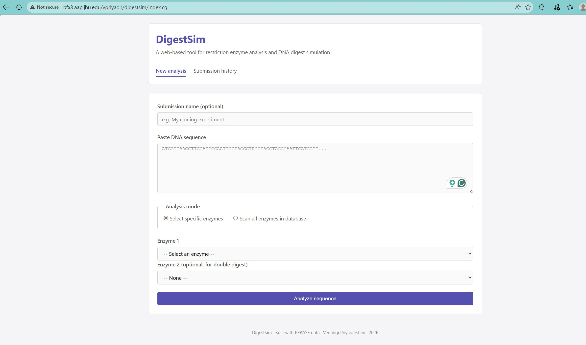
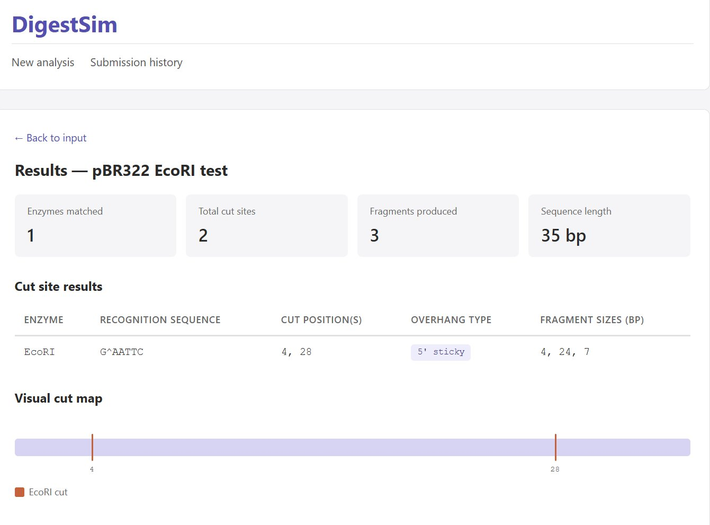
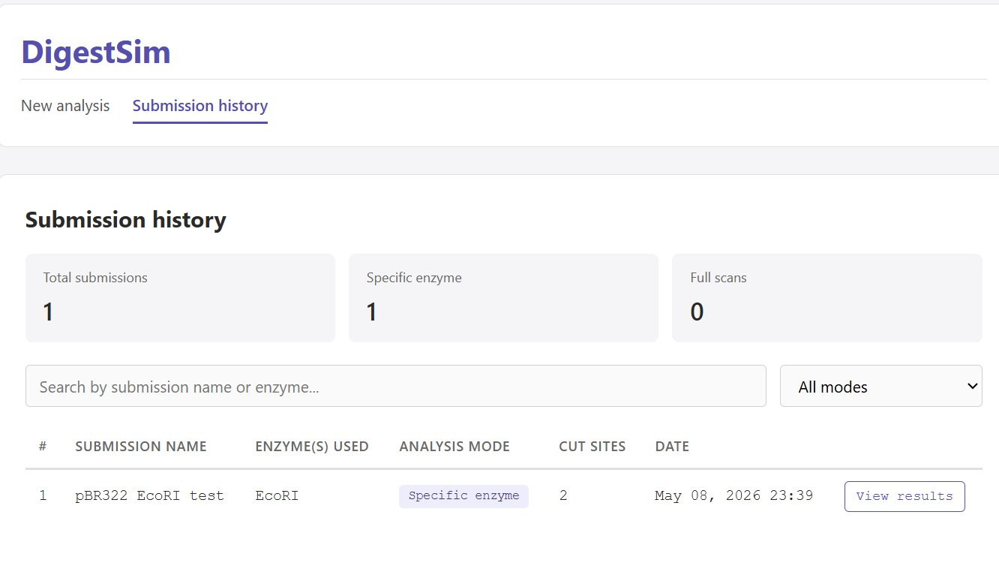

# 🧬 DigestSim

> A web-based tool for restriction enzyme analysis and DNA digest simulation.




DigestSim lets molecular biologists plan and validate restriction enzyme digestion experiments entirely in silico. Paste any DNA sequence, choose specific enzymes (or scan all 718 in the database), and instantly see cut positions, fragment sizes, overhang types, and a visual cut map — saving time and reducing wet-lab errors before a single tube is touched.

**[Features](#features) • [Tech stack](#tech-stack) • [Three ways to run it](#three-ways-to-run-it) • [Screenshots](#screenshots) • [Try it yourself](#try-it-yourself) • [References](#references)**

> **🚀 Live demo:** **[ved2213.pythonanywhere.com](https://ved2213.pythonanywhere.com)** — try the app right now, no install needed.

---

## Features

- 🔍 **Two analysis modes** — pick one or two specific enzymes for a single or double digest, or scan the entire database to find every enzyme whose recognition sequence appears in your DNA.
- 📊 **Detailed results** — cut positions, fragment sizes, overhang type (5′ sticky, 3′ sticky, blunt), and the recognition sequence with the cut site marked.
- 📈 **Visual cut map** — interactive linear DNA map with color-coded cut markers per enzyme.
- 🕓 **Submission history** — every analysis is saved and searchable; revisit and compare past results anytime.
- 🧹 **Smart input cleaning** — automatically strips FASTA headers, whitespace, numbers, and lowercase letters before analysis.
- 🗄️ **718 enzymes from REBASE** — Type II enzymes with non-degenerate recognition sequences, parsed from the official REBASE bionet file.

## Tech stack

**Backend:** Python 3, Flask (portfolio version) or CGI (academic version), SQLite / MySQL, Apache with mod_cgi (academic version)

**Frontend:** HTML5 semantic markup, CSS3 (no frameworks — handwritten), JavaScript + jQuery 3.7 for client-side interactivity

**Data:** [REBASE](http://rebase.neb.com) — The Restriction Enzyme Database (Roberts et al., 2015)

**Deployment:** PythonAnywhere (live demo), Docker (containerized)

**Principles:**
- Strict content separation (no HTML in Python, no inline CSS/JS in HTML)
- Templating-based rendering (Jinja2 for Flask, placeholder substitution for CGI)
- Normalized two-table relational schema

## Three ways to run it

| Method | Best for | How |
|---|---|---|
| 🌐 **Live demo** | Just trying it out | Visit [ved2213.pythonanywhere.com](https://ved2213.pythonanywhere.com) |
| 🐳 **Docker** | Quick local setup | `cd flask_app && docker compose up` — then open http://localhost:5000 |
| 🐍 **Python + Flask** | Developers who want to tinker | `cd flask_app && pip install -r requirements.txt && python app.py` |

The repo also contains the **original CGI + MySQL version** (project root) from the Johns Hopkins class submission.

## Screenshots

### Input page


### Results page with visual cut map


### Submission history


## Try it yourself

On the live demo (or any local instance), try these sample inputs:

### 1. Simple EcoRI digest

- **Submission name:** `My first test`
- **DNA sequence:** `AAAGAATTCAAACCCGGGAAGCTTTTTGAATTCAA`
- **Mode:** Select specific enzymes
- **Enzyme 1:** `EcoRI`
- **Expected result:** 1 enzyme matched, 2 cut sites (at positions 4 and 28), 3 fragments of sizes 4, 24, 7

### 2. pUC19 polylinker (full scan)

- **Submission name:** `pUC19 MCS`
- **DNA sequence:** `GAATTCGAGCTCGGTACCCGGGGATCCTCTAGAGTCGACCTGCAGGCATGCAAGCTT`
- **Mode:** Scan all enzymes in database
- **Expected result:** Matches for EcoRI, SacI, KpnI, SmaI, BamHI, XbaI, SalI, PstI, SphI, HindIII, plus REBASE isoschizomers (20+ enzymes total)

### 3. FASTA input (cleaning demo)

- **DNA sequence (paste exactly, with header and lowercase):**
  ```
  >my_test_sequence
  atgctt aagctt ggat
  ccgaa ttcgta cgcta
  ```
- **Mode:** Select specific enzymes
- **Enzyme 1:** `EcoRI`
- **Enzyme 2:** `HindIII`
- **Expected result:** input cleaned to `ATGCTTAAGCTTGGATCCGAATTCGTACGCTA`, then analysis runs normally.

### 4. No cuts (empty result handling)

- **DNA sequence:** `AAAAAAAAAAAAAAAAAAAAAAAAAAAA`
- **Enzyme 1:** `EcoRI`
- **Expected result:** "No cut sites found for the selected enzymes."

## Installation

### Flask + SQLite (recommended)

Zero database setup — SQLite is a single file that's created automatically.

```bash
git clone https://github.com/vpriyad1/digestsim.git
cd digestsim/flask_app
pip install -r requirements.txt
python app.py
```

Then open http://localhost:5000 in your browser. Done.

### Docker

```bash
git clone https://github.com/vpriyad1/digestsim.git
cd digestsim/flask_app
docker compose up
```

Then open http://localhost:5000 in your browser.

### Original CGI + MySQL (academic version)

The class-submission version in the project root uses Apache CGI and MySQL. Setup steps:

**1. Clone and enter the project root**

```bash
git clone https://github.com/vpriyad1/digestsim.git
cd digestsim
```

**2. Set up the MySQL database**

```bash
mysql -u your_user -p your_database < sql/create_tables.sql
mysql -u your_user -p your_database < sql/populate_enzymes.sql
```

**3. Create your database config** in `lib/db_config.py` (gitignored):

```python
DB_HOST = 'localhost'
DB_USER = 'your_user'
DB_PASSWORD = 'your_password'
DB_NAME = 'your_database'
```

**4. Make CGI scripts executable**

```bash
chmod +x index.cgi cgi/*.cgi
```

**5. Deploy to your Apache web root** and access via browser.

### Optional: Refresh enzyme data from REBASE

```bash
wget http://rebase.neb.com/rebase/link_bionet -O data/link_bionet.txt
python3 scripts/parse_rebase.py data/link_bionet.txt sql/populate_enzymes.sql
```

## Project structure

```
digestsim/
├── flask_app/                   # Portfolio version: Flask + SQLite + Docker
│   ├── app.py                   # Flask application (all routes + analysis logic)
│   ├── requirements.txt
│   ├── Dockerfile
│   ├── docker-compose.yml
│   ├── templates/               # Jinja2 templates
│   ├── static/css/              # External stylesheet
│   ├── static/js/               # External JavaScript (main, results, history)
│   └── data/                    # Schema + seed data
│
├── index.cgi                    # Academic version: Homepage CGI
├── cgi/                         # Academic version: CGI scripts
│   ├── analyze_sequence.cgi
│   ├── get_history.cgi
│   └── view_submission.cgi
├── templates/                   # Academic version: HTML templates
├── css/style.css
├── js/                          # Client-side interactivity
├── lib/
│   ├── db_config.py             # DB credentials (gitignored)
│   ├── db_connect.py            # MySQL connection helper
│   └── digest_logic.py          # Core analysis
├── sql/
│   ├── create_tables.sql        # MySQL schema
│   └── populate_enzymes.sql     # 718 enzyme INSERTs (auto-generated)
├── scripts/
│   └── parse_rebase.py          # REBASE bionet parser
├── data/
│   └── link_bionet.txt          # REBASE source data
├── docs/
│   └── screenshots/             # README images
├── README.md
└── Final Project Proposal.pdf
```

## Database schema

Two tables:

| Table | Purpose |
|---|---|
| `enzyme_db` | Reference table of 718 Type II restriction enzymes from REBASE — name, recognition sequence, cut position, overhang type, enzyme type, commercial supplier. |
| `submissions` | Records of every analysis run through the app — submission name, DNA sequence, enzymes used, mode, cut positions, fragment sizes, timestamp. |

## References

- Roberts RJ, Vincze T, Posfai J, Macelis D. (2015). REBASE — a database for DNA restriction and modification: enzymes, genes and genomes. *Nucleic Acids Research*, 43:D298–D299. [doi:10.1093/nar/gku1046](https://doi.org/10.1093/nar/gku1046)
- Pingoud A, Wilson GG, Wende W. (2014). Type II restriction endonucleases — a historical perspective and more. *Nucleic Acids Research*, 42(12):7489–7527. [doi:10.1093/nar/gku447](https://doi.org/10.1093/nar/gku447)
- Yanisch-Perron C, Vieira J, Messing J. (1985). Improved M13 phage cloning vectors and host strains: nucleotide sequences of the M13mp18 and pUC19 vectors. *Gene*, 33(1):103–119.
- REBASE — The Restriction Enzyme Database. New England Biolabs. http://rebase.neb.com

## Acknowledgments

Originally built as the final project for **AS.410.712.81 — Advanced Practical Computer Concepts for Bioinformatics** at **Johns Hopkins University**, Spring 2026. Refactored to Flask + SQLite + Docker for portfolio deployment.

## Author

**Vedangi Priyadarshini**
M.S. Bioinformatics, Johns Hopkins University
[GitHub](https://github.com/vpriyad1)
